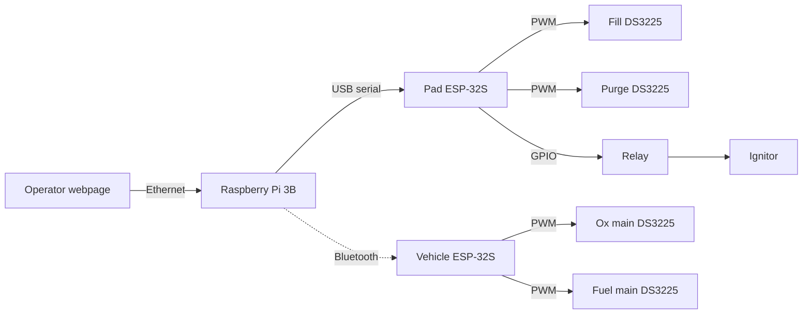
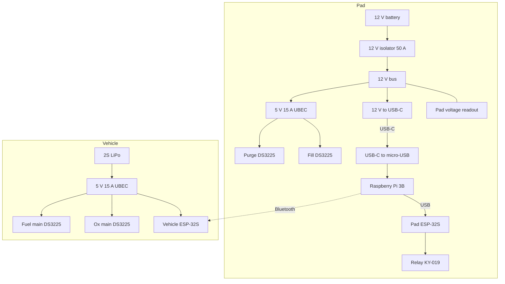

# Ground Support Equipment Overview

Pad and vehicle are electrically separate. No electrical QD. No camera.

- **Raspberry Pi 3B (pad)** runs the webpage. USB serial to the pad ESP-32S. Bluetooth to the vehicle ESP-32S. Powered 12 V → USB-C module → USB-C to micro-USB.
- **Pad ESP-32S** PWM for fill and purge. GPIO for one relay (ignitor). Powered from the Pi USB.
- **Vehicle ESP-32S** PWM for ox and fuel mains. Bluetooth only. 2S LiPo → 5 V 15 A UBEC → ESP32 5 V pin and both main-valve servos.
- Pad 12 V battery → 50 A isolator → 12 V bus: USB-C module (Pi) and the other 5 V 15 A UBEC (fill and purge servos).
- **4× DS3225** (25 kg, 180°): fill, purge, ox main, fuel main. **2× 5 V 15 A UBECs**: one pad, one vehicle.

## Pad

### 12 V battery
Powers the whole ground station.

### 12 V isolator
50 A battery disconnect on the 12 V pack.

### Pad voltage readout
12–24 V panel meter on the pack.

### 12 V to USB-C
LX-CACPS terminal module, 12 V in, USB-C out. Two in the pack; one used for the Pi.

### USB-C to micro-USB
0.3 m cable into the Pi 3B power jack.

### Raspberry Pi 3B
Webpage, USB to the pad ESP-32S, Bluetooth to the vehicle ESP-32S.

### Ethernet
Operator link to the Pi, 100 m.

### Pad ESP-32S
USB from the Pi. Fill PWM, purge PWM, one relay GPIO. Spare board is the vehicle unit.

### Relay
KY-019 5 V 1-channel. One used for the ignitor. Five in the pack.

### Pad servo UBEC
5 V 15 A UBEC, 12 V in. Fill and purge DS3225s.

### Fill and purge servos
Two of the four DS3225 25 kg 180° pack. PWM from the pad ESP-32S. 5 V from the pad UBEC.

## Vehicle

### 2S LiPo
Onboard pack.

### Vehicle servo UBEC
The second 5 V 15 A UBEC, 2S in. Vehicle ESP-32S 5 V pin and both main-valve servos.

### Vehicle ESP-32S
Bluetooth from the Pi. Ox and fuel PWM. 5 V from the vehicle UBEC (header, not USB-C in operation).

### Main valve servos
The other two DS3225s. PWM from the vehicle ESP-32S. 5 V from the vehicle UBEC.

## Parts

AliExpress cart prices as shown (tax extra). Blank = not in this cart. **Cart total** is the filled AliExpress lines.

| Component | Qty | Section | Link | Price |
| --- | --- | --- | --- | --- |
| 12 V battery | 1 | [[#12 V battery]] | | |
| 12 V isolator 50 A | 1 | [[#12 V isolator]] | AliExpress | 6.59 |
| Pad voltage readout | 1 | [[#Pad voltage readout]] | AliExpress 12–24 V | 9.29 |
| 12 V to USB-C | 2 | [[#12 V to USB-C]] | AliExpress LX-CACPS | 7.39 |
| USB-C to micro-USB 0.3 m | 1 | [[#USB-C to micro-USB]] | [SUNKANDI](https://www.aliexpress.com/) | 3.31 |
| Raspberry Pi 3B | 1 | [[#Raspberry Pi 3B]] | | |
| Ethernet 100 m | 1 | [[#Ethernet]] | | |
| ESP-32S | 2 | [[#Pad ESP-32S]] / [[#Vehicle ESP-32S]] | AliExpress Type-C 4 MB | 21.19 |
| Relay KY-019 | 5 | [[#Relay]] | AliExpress | 9.69 |
| 5 V 15 A UBEC | 2 | [[#Pad servo UBEC]] / [[#Vehicle servo UBEC]] | AliExpress | 26.19 |
| DS3225 25 kg 180° | 4 | [[#Fill and purge servos]] / [[#Main valve servos]] | AliExpress | 64.20 |
| 2S LiPo | 1 | [[#2S LiPo]] | | |
| Pi 5 Active Cooler | 1 | — | AliExpress (Pi 5 mount) | 7.30 |
| Diagonal pliers | 1 | — | AliExpress | 11.09 |
| **Cart total** | | | | **166.24** |

## Related

- [[01-Propulsion System Overview]]
- [[03-Fluid System]]
- [[01-Requirements/Requirements]]
- [[03-Testing/Testing Index]]
- [[04-Procurement/Procurement Index]]
