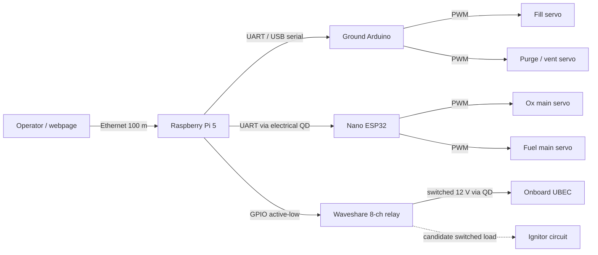
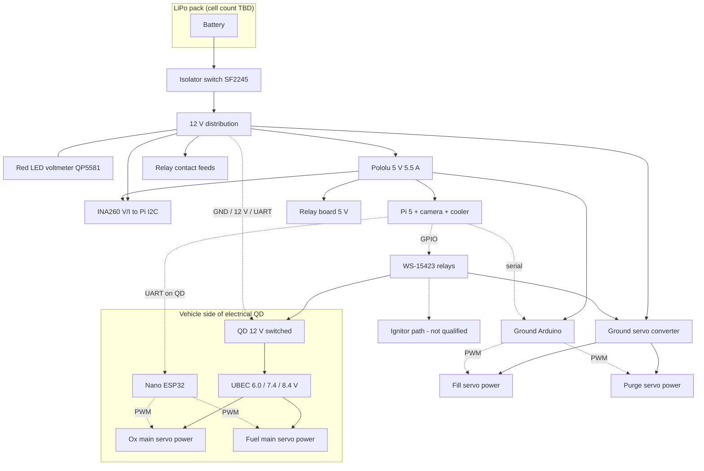

# Ground Support Equipment Overview

**Status:** electronics architecture candidate. Not a qualified live-propellant or ignition system.

Remote fill, dump, valve command and ignition inhibit must remain operable from the [Tripoli Safe Distance Table](https://www.tripoli.org/safetycode) distance. A 100 m Ethernet run is a communications choice, not proof of a safe operator distance.

## Architecture summary

Ground station and vehicle are electrically split.

- **Raspberry Pi 5 (ground)** runs the operator webpage, Camera Module 3, battery telemetry, and talks to both Arduinos. It can generate hardware PWM on the RP1 chip (four channels), but PWM for the valves is **not** taken from the Pi. That keeps valve timing off the Linux/webpage path and gives a defined boot/crash behaviour on the microcontrollers.
- **Ground Arduino** generates PWM for the **fill** and **purge/vent** servos. Those servos are powered from a 12 V → servo-voltage converter, not from GPIO.
- **Arduino Nano ESP32 (onboard)** generates PWM for the **oxidiser main** and **fuel main** servos. A UBEC on the vehicle supplies those two servos. Command and battery voltage reach the vehicle through an electrical QD. The ESP32-S3 LEDC peripheral can generate eight independent hardware PWM channels; only two are required here.
- **Waveshare RPi Relay Board (B) / WS-15423** provides isolated on/off switching (GPIO, 3.3 V/5 V, **active-low**). Relays do **not** command servo position. Candidate uses: switched 12 V to the vehicle QD, switched power to ground-servo converter, ignitor circuit (unqualified — see Ignition), and spares.

Valves are quarter-turn ball valves with servo horns (see [[01-Propulsion System Overview]]). Mechanical relays are on/off only.

## How it is intended to work

1. Isolator on, local red voltmeter and INA260 confirm pack voltage before the Pi boots.
2. Pi boots; webpage is reached over Ethernet. Relay inputs are treated as **unsafe until explicitly inhibited** (board is active-low; GPIO can glitch during boot).
3. Ground Arduino holds fill and purge servos in a defined safe position (fill closed, dump/vent per procedure).
4. Electrical QD connected. Onboard ESP32 is commanded over UART. Main valves remain closed until the sequence calls for them.
5. Fill: open fill servo, load N₂O per procedure, close fill. Purge/vent as required by [[03-Fluid System]].
6. Arm path: separate physical inhibit still required. Software on the Pi or a relay coil is **not** the ignition inhibit.
7. Open vehicle main valves (ox and fuel), then ignite only if inhibits are removed and the sequence is satisfied.
8. At disconnect, vehicle servos lose QD power. Ball valves stay at last mechanical angle if the servo is not back-driven. **Fail-safe on QD pull is not yet specified** (must be closed for abort/hold-down disconnect; must be open for launch after commanded open).

## Electrical design candidate

### Power

Nominal ground supply is a **LiPo pack** described as 12 V. Cell count is not frozen (2S = 8.4 V full; 3S = 12.6 V full; 4S = 16.8 V full). Every regulator below must be checked against the actual pack.

| Rail | Candidate part | Role |
| --- | --- | --- |
| Pack disconnect | Jaycar [SF2245](https://www.jaycar.com.au/) 120 A battery isolation switch | Manual isolator. Not an independent emergency-stop system. |
| Local voltage readout | Jaycar [QP5581](https://www.jaycar.com.au/) self-powered red LED voltmeter, 4.5–30 V DC | Panel meter across the pack. Independent of the Pi. |
| Webpage telemetry | Adafruit INA260 | I²C, 3.3 V logic. Voltage, current, power. Not a BMS or remaining-capacity gauge. Do not put all four servo stall currents through it unless the installation is sized for that. |
| 5 V logic / Pi | Pololu D36V50F5, 5 V / 5.5 A | Pi 5, Camera Module 3, Active Cooler, relay board 5 V, ground Arduino, INA260. Thermal and connector interface still need validation. **Not** a USB-C PD brick. |
| Ground servos | 12 V → servo-voltage converter / BEC | Fill + purge servos only. Size for **both stalling together**. |
| Vehicle servos | UBEC on airframe (Hobbywing UBEC 10 A V2 is a candidate: 2S–6S in, 6.0 / 7.4 / 8.4 V out, 10 A cont. / 15 A peak). AliExpress multi-current UBECs unverified. | Ox + fuel servos. Set output to the servo rating, not blindly to 5 V. |

**BEC sizing (provisional, two servos):**

| Stall per servo | Two servos | Continuous BEC target with headroom |
| --- | --- | --- |
| 2 A | 4 A | 5–6 A |
| 3 A | 6 A | 8–10 A |
| 5 A | 10 A | 12–15 A |

Do not treat a BEC’s brief peak rating as continuous capacity. Current valve candidate in propulsion is the DS3225-class servo; stall current and rated voltage still need the actual listing.

Waveshare 5 V from the Pi header and the 5 V terminal block are **linked internally**. Do not feed both from different supplies. GPIO must not power relay coils; the board’s drivers do that from the 5 V rail.

Fuses, wire gauge, distribution blocks, enclosure and glands are **not selected** until pack voltage and peak currents are known.

### Signal vs power

| Device | What the Pi / Arduino provides | What must be separate |
| --- | --- | --- |
| Servos | PWM (or serial command to the MCU that makes PWM), 3.3 V logic | Servo-rated supply (converter / UBEC), common ground |
| Relay board | 3.3 V GPIO, active-low | 5 V board power, load on the contact side |
| Bare solenoid / motor / relay coil | Nothing useful from GPIO | Driver + coil suppression |
| Camera Module 3 | CSI, 3.3 V | Pi 5 22-pin camera cable (200 mm included; 500 mm adapter optional) |

### Raspberry Pi 5 (ground)

- Official Raspberry Pi 5 Active Cooler on the dedicated fan header.
- Camera Module 3 with Pi 5-compatible cable ([Core Electronics](https://core-electronics.com.au/), Camera Module 3 ~$48.50; optional 500 mm 22-pin→15-pin adapter ~$5.38). One camera, one cable.
- Webpage (python-bottle examples exist for the relay board; that is not a safety architecture).
- INA260 on I²C for displayed pack voltage/current.
- UART to ground Arduino and UART (through QD) to Nano ESP32.
- GPIO to relay IN pins **after** boot-safe defaults are designed (pull resistors / inhibit so relays do not pick during boot, crash or reset).

The Pi 5 RP1 PWM block is spare capacity, not the valve control path.

### Ground Arduino (fill and vent)

Drives two PWM channels:

1. Fill valve servo  
2. Purge / vent valve servo  

Arduino UNO Q was a price-watch candidate only. Any 5 V (or 3.3 V with level-safe servo signals) Arduino with two hardware-timed PWM outputs is electrically sufficient for this pair. Power the MCU from the 5 V logic rail. **Common ground** with the ground-servo converter.

### Onboard Arduino Nano ESP32 (main valves)

- USB/5 V for the MCU from a regulated 5 V tap (do not feed the ESP32 from raw LiPo).
- UBEC output to ox and fuel servo power pins.
- Common ground: pack negative, UBEC, ESP32, servos, QD return.
- Two PWM pins to the two main-valve servos.
- UART from ground Pi via electrical QD.

If the QD disconnects, the ESP32 and UBEC lose ground-supplied power unless a separate onboard pack is added later. Valve last-position behaviour must be designed, not assumed.

### Relay board (Waveshare WS-15423)

[Core Electronics listing](https://core-electronics.com.au/) (~$38.35 AUD inc GST). Specs from that listing:

- 8 × SPDT, 5 A 250 V AC or 5 A 30 V DC  
- Trigger 3.3 V / 5 V, photocoupler isolation  
- DIN-rail case, status LEDs, pin-select jumpers, reserved PLC-style inputs  
- **GPIO control, not PCIe / SPI / UART**

Suggested channel allocation (candidate, not wired yet):

| Channel | Load |
| --- | --- |
| CH1 | Switched 12 V to vehicle QD / UBEC input |
| CH2 | Enable ground-servo converter |
| CH3 | Ignitor (unqualified — see below) |
| CH4–CH8 | Spare / future inhibit loops / 12 V status lamp |

Contact rating alone does not make a channel suitable for an energetic ignitor. DC inductive and firing loads need a separately reviewed firing circuit, physical isolation, and an inhibit that does not depend only on the Pi or relay software.

Startup: active-low inputs can close relays during Pi boot. Design the jumper/polarity and a hardware inhibit so fill, mains and ignitor cannot energise unintentionally.

### Actuators

Current mechanical candidate (from [[01-Propulsion System Overview]]): 1/4" NPT brass full-port 1000 psi ball valve with 3D-printed horn and DS3225-class servo, for ox fill, ox main and fuel main. Purge/vent uses the same class unless the valve differs.

A device that “turns 90° when powered from 12 V” may be an industrial quarter-turn actuator (slow, different fail behaviour), not a PWM servo. Industrial examples such as AVFI EOM-1 (~12 s / 90°) are **not** selected.

Do not purchase actuators until these are known:

- Valve model and breakaway / running torque under pressure  
- Required 90° time under load (“fast” in seconds)  
- Horn / shaft interface and any position feedback  
- Required state when power or the electrical QD is lost  

### Battery, Ethernet, lamp

- **LiPo:** chemistry and cell count TBD. Fully charged voltage drives regulator choice. Add pack-level protection matched to the actual pack; the isolator is not that protection.
- **Ethernet:** 100 m copper is at the usual length limit. Include patch leads. Prefer confirmed pure-copper outdoor Cat6 (ComKonect outdoor cable was a candidate; Kogan 100 m listing was not verified). Test the deployed link. Length ≠ safe distance.
- **12 V light readout:** implemented as the Jaycar QP5581 red voltmeter. A separate 12 V status lamp can use a spare relay channel if wanted later.

## Electrical diagram

Power in solid lines, control dashed. Fuses shown as functional blocks; ratings TBD.

**Wiring rules**

- One pack negative as system ground; join Pi, both MCUs, both BECs/UBECs, INA260 and QD return there.  
- Servo signal 3.3 V is acceptable if the servo datasheet allows it; otherwise level-shift.  
- Do not power servos from MCU 5 V pins.  
- Do not assume INA260 can carry the whole actuator bus.  
- Relay NO/NC chosen so a de-energised relay is the safe contact state for that load.

## Fill and drain

Remote fill and dump as required for non-commercial tanks ([[01-Requirements/Requirements]]).

| Function | Location | Drive |
| --- | --- | --- |
| Fill valve | Ground / pad | Ground Arduino PWM + ground servo converter |
| Purge / vent / dump | Ground / pad | Ground Arduino PWM + ground servo converter |
| Ox main | Vehicle, electrical QD | Nano ESP32 + UBEC |
| Fuel main | Vehicle, electrical QD | Nano ESP32 + UBEC |

Fluid QD, electrical QD, and any combined QD must be labelled separately. Fluid interfaces are in [[03-Fluid System]].

## Pressurization panel

N₂O is self-pressurising; no GSE regulator is in the propulsion baseline. Panel work is gauges, fill line, vent, and the electrical controls above. Hardware still TBD.

## Ignition system

Candidate only: one Waveshare channel switching an ignitor circuit.

**Not accepted as-is.** A hobby 5 A relay, Pi GPIO and webpage software do not constitute a firing system. Required before any live ignitor:

- Physical arm/disarm independent of the Pi (key, fire switch, or equivalent)  
- Defined safe state on boot, crash, power loss and QD disconnect  
- Continuity / inhibit logic that cannot be satisfied by a single stuck relay or GPIO  
- Load type and current matched to a purpose-designed driver, not only the relay datasheet  

## Test stand

Thrust measurement, instrumentation and hold-down are not part of this electronics candidate.

## Parts shortlist (prototype electronics)

Prices AUD inc GST where previously verified; exclude delivery. Actuators held.

| Item | Part / link | Price | Notes |
| --- | --- | --- | --- |
| Camera | Raspberry Pi Camera Module 3 — Core Electronics | $48.50 | Pi 5 200 mm adapter cable included on that listing |
| Camera cable (optional) | Pi 5 camera FPC 500 mm, 22-pin to 15-pin | $5.38 | Buy one if 200 mm is too short |
| Pi cooling | Official Raspberry Pi 5 Active Cooler | check listing | Dedicated fan connector |
| Relay board | Waveshare WS-15423 8-ch | $38.35 | GPIO, active-low, 3.3 V/5 V. Not servo PWM |
| 5 V converter | Pololu D36V50F5 5 V / 5.5 A | $57.40 | Candidate; validate interface and heat |
| Battery telemetry | Adafruit INA260 | $18.45 | I²C, 36 V / 15 A advertised continuous — installation-dependent |
| Local red readout | Jaycar QP5581 | check listing | 4.5–30 V DC |
| Isolator | Jaycar SF2245 120 A | check listing | Manual disconnect only |
| Ethernet | 100 m Cat6 outdoor copper (ComKonect candidate) | check listing | Verify copper, rating, terminations. Kogan listing unverified |
| Ground servo supply | 12 V → servo-voltage BEC | TBD | Two ground servos, stall-based current |
| Vehicle servo supply | Hobbywing UBEC 10 A V2 or verified equivalent | ~$58 OZRC when in stock | Confirm continuous current and output voltage vs servos |
| Ground MCU | Arduino (UNO Q was a watch item) | TBD | Fill + purge PWM |
| Vehicle MCU | Arduino Nano ESP32 | TBD | Two main-valve PWM + UART |
| AliExpress UBECs / other carts | item 1005006049299888 and others | — | Pages not verified; do not order from title alone |

Still required and **not** on this list: fused distribution, wiring, connectors, enclosure, glands, battery protection, firing-circuit parts, valve servos.

## Open items

1. LiPo cell count, capacity, connector and protection.  
2. Servo model, rated voltage, stall current, 90° loaded time.  
3. Valve models and torque under pressure.  
4. Electrical QD pinout and fail-safe on disconnect.  
5. Whether fill/dump is the same mechanical valve as purge.  
6. Ignition architecture beyond a relay channel.  
7. Fuse and wire sizes after currents are known.  
8. Confirm “12 V light readout” is only the voltmeter, or also a status lamp.  
9. Ethernet cable conductor and outdoor rating before purchase.

## Related

- [[01-Propulsion System Overview]]
- [[03-Fluid System]]
- [[01-Requirements/Requirements]]
- [[03-Testing/Testing Index]]
- [[04-Procurement/Procurement Index]]
