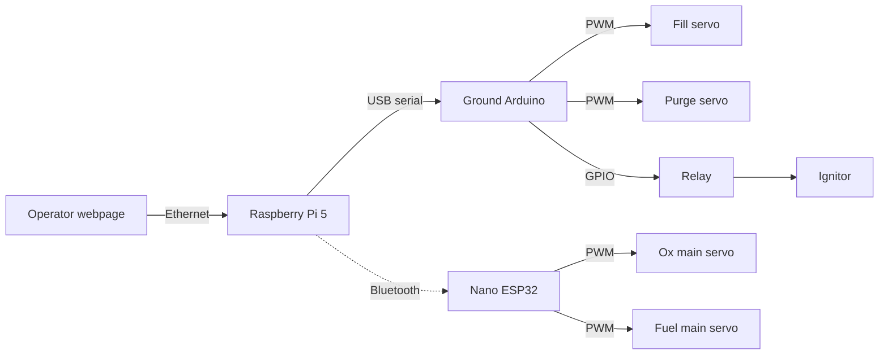
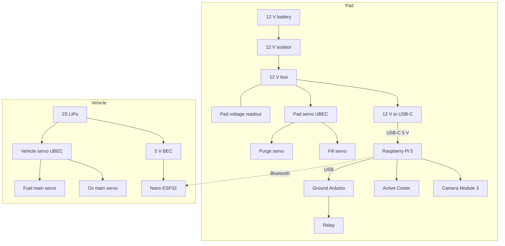

# Ground Support Equipment Overview

Pad and vehicle are electrically separate. No electrical QD.

- **Raspberry Pi 5 (pad)** runs the webpage and camera. USB serial to the ground Arduino. Bluetooth to the Nano ESP32.
- **Ground Arduino (pad)** PWM for fill and purge. GPIO for one relay (ignitor). Powered from the Pi USB.
- **Nano ESP32 (vehicle)** PWM for ox and fuel mains. Bluetooth only. 2S LiPo → 5 V BEC → ESP32. Separate UBEC for the two servos.
- Pad 12 V battery → isolator → 12 V to USB-C for the Pi (Arduino, camera, cooler, relay 5 V hang off that). Same 12 V → pad servo UBEC for fill and purge.

## Pad

### 12 V battery
Powers the whole ground station.

### 12 V isolator
Manual disconnect on the 12 V pack.

### Pad voltage readout
Local display of pack voltage.

### 12 V to USB-C
52Pi EP-0225: 9–24 V DC in, USB-C 5 V / 5 A out to the Pi 5. Arduino, camera, cooler and relay 5 V run from the Pi.

### Raspberry Pi 5
Webpage, camera, USB to the ground Arduino, Bluetooth to the ESP32.

### Camera Module 3
On the Pi 5 camera port.

### Active Cooler
Official Pi 5 cooler on the fan header.

### Ethernet
Operator link to the Pi, 100 m.

### Ground Arduino
USB from the Pi. Fill PWM, purge PWM, one relay GPIO.

### Relay
Single 5 V relay module, Arduino GPIO, ignitor circuit.

### Pad servo UBEC
Hobbywing UBEC 10 A V2. 12 V in (2–6S / 6–25.2 V), 6.0 / 7.4 / 8.4 V out at 10 A. Fill and purge servos.

### Fill and purge servos
Quarter-turn ball valves on the pad. PWM from the ground Arduino. Power from the pad servo UBEC.

## Vehicle

### 2S LiPo
Onboard pack. Wireless vs the pad.

### 5 V BEC
Adafruit UBEC 5 V / 3 A. 2S in, 5 V out to the Nano ESP32.

### Nano ESP32
Bluetooth from the Pi. Ox and fuel PWM.

### Vehicle servo UBEC
Same Hobbywing UBEC 10 A V2 as the pad, on 2S. Ox and fuel servos.

### Main valve servos
Ox main and fuel main. PWM from the ESP32. Power from the vehicle servo UBEC.

## Parts

Prices AUD inc GST where listed. Blank price = not chosen yet. **Listed total** is filled cells only.

| Component | Section | Link | Price |
| --- | --- | --- | --- |
| 12 V battery | [[#12 V battery]] | | |
| 12 V isolator | [[#12 V isolator]] | | |
| Pad voltage readout | [[#Pad voltage readout]] | | |
| 12 V to USB-C | [[#12 V to USB-C]] | [52Pi EP-0225, Core](https://core-electronics.com.au/pd-power-expansion-board-raspberry-pi-5.html) | 58.45 |
| Raspberry Pi 5 | [[#Raspberry Pi 5]] | | |
| Camera Module 3 | [[#Camera Module 3]] | [CE09425, Core](https://core-electronics.com.au/raspberry-pi-camera-3.html) | 48.50 |
| Active Cooler | [[#Active Cooler]] | [CE09791, Core](https://core-electronics.com.au/raspberry-pi-5-active-cooler.html) | 8.80 |
| Ethernet 100 m | [[#Ethernet]] | | |
| Ground Arduino | [[#Ground Arduino]] | | |
| Relay | [[#Relay]] | [5 V 1-ch 10 A, Core](https://core-electronics.com.au/5v-single-channel-relay-module-10a.html) | 3.95 |
| Pad servo UBEC | [[#Pad servo UBEC]] | [Hobbywing 10 A V2, World Hobbies](https://www.worldhobbies.com.au/ubec-10a-v2-car-2-6s) | 54.00 |
| Fill servo | [[#Fill and purge servos]] | | |
| Purge servo | [[#Fill and purge servos]] | | |
| 2S LiPo | [[#2S LiPo]] | | |
| 5 V BEC | [[#5 V BEC]] | [Adafruit 5 V 3 A, Core](https://core-electronics.com.au/ubec-dc-dc-step-down-buck-converter-5v-at-3a-output.html) | 17.75 |
| Nano ESP32 | [[#Nano ESP32]] | [ABX00092, Core](https://core-electronics.com.au/arduino/boards/arduino-nano-boards.html) | 31.80 |
| Vehicle servo UBEC | [[#Vehicle servo UBEC]] | [Hobbywing 10 A V2, World Hobbies](https://www.worldhobbies.com.au/ubec-10a-v2-car-2-6s) | 54.00 |
| Ox main servo | [[#Main valve servos]] | | |
| Fuel main servo | [[#Main valve servos]] | | |
| **Listed total** | | | **277.25** |

## Related

- [[01-Propulsion System Overview]]
- [[03-Fluid System]]
- [[01-Requirements/Requirements]]
- [[03-Testing/Testing Index]]
- [[04-Procurement/Procurement Index]]
